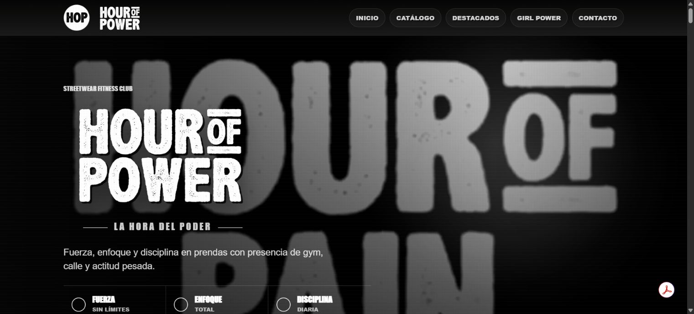
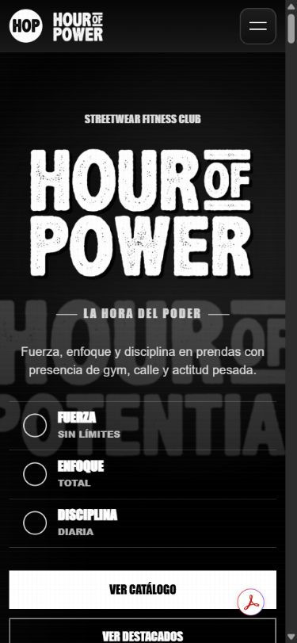
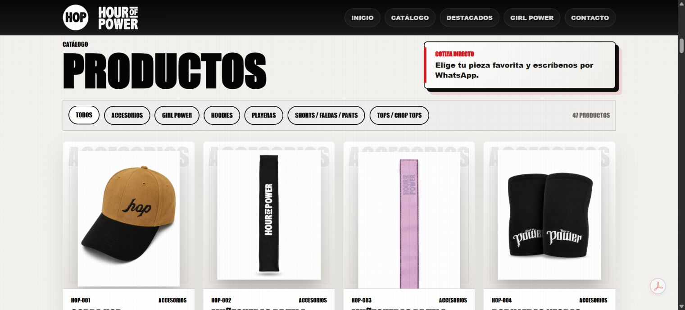
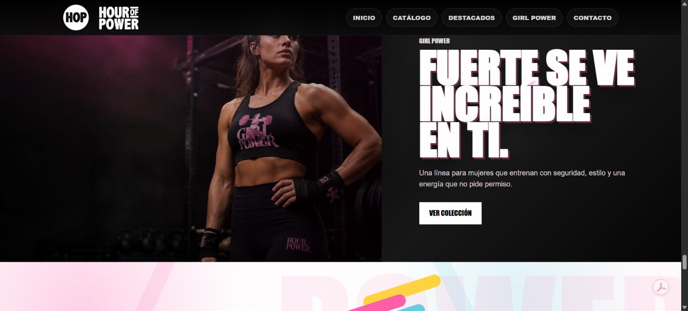
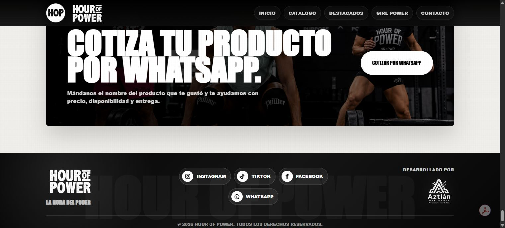

# Hour of Power México

Catálogo web de ropa y accesorios deportivos. Diseñé y desarrollé este proyecto comercial de forma individual a través de **Aztlán Web Group**.

**Estado:** sitio en producción. **[Visitar el catálogo publicado](https://hourofpower.com.mx/)**

## Problema y solución

La marca necesitaba un lugar para reunir sus productos, mostrar sus colecciones y facilitar las consultas de clientes. El catálogo permite explorar el surtido por categoría y contactar al vendedor para cotizar por WhatsApp.

## Funcionalidades

- Filtros por categoría para explorar prendas y accesorios.
- Fichas de producto con imágenes, descripción y acceso directo a la consulta por WhatsApp.
- Secciones de productos destacados y colección Girl Power.
- Interfaz adaptada a escritorio y teléfono.

## Tecnologías

HTML, CSS y JavaScript para la estructura, la presentación y la interacción del catálogo. Herramientas de IA como apoyo para optimizar las imágenes de producto.

## Mi contribución

Realicé el diseño y el desarrollo completo del sitio. Definí la navegación, los filtros, las fichas y la presentación de las colecciones. También optimicé y adapté los recursos visuales proporcionados por el cliente con apoyo de IA e integré las consultas por WhatsApp.

## Resultados

El sitio ofrece un catálogo público navegable. El vendedor atiende por WhatsApp las consultas de precio, disponibilidad y entrega.

## Evidencias del sitio publicado

### Portada en escritorio y móvil

 

### Catálogo y colección Girl Power

 

### Consulta por WhatsApp

## Créditos

Diseño y desarrollo de Arturo Ortiz Berthely a través de [Aztlán Web Group](https://aztlanwebgroup.com/). Marca y contenidos comerciales de Hour of Power México.
